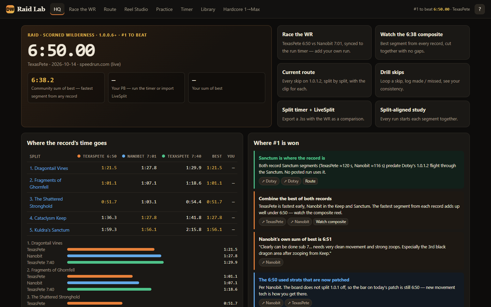

# Dragonwilds Raid Lab

Scorned Wilderness raid speedrun lab for RuneScape: Dragonwilds, built to take the #1 spot on the speedrun.com Raid board (1.0.0.6+). The current record is **6:50.00** (TexasPete).



## Run it

```bash
npm install     # dev only: Playwright test runner (uses your installed Edge)
npm start       # http://localhost:5173
```

The site has no build step and nothing to bundle. It has to be served over http, because ES modules and the YouTube iframe API both fail on `file://`. GitHub Pages serves it as-is from `main`.

## What's in it

| Page | What it does |
|---|---|
| **HQ** | Shows the live #1 from speedrun.com, the community sum of best (the fastest segment from any record, 6:38), where each record's time goes per split, and where #1 is won, with sources. |
| **Race the WR** | Plays up to 4 runs on one run clock. *Race* puts every video on the same timer value. *Split-aligned* starts every segment together, and faster runs wait on their split. Shows live deltas. Split marks can be adjusted live (±0.1 s, "= now") and every change re-syncs instantly. You can add your own run from a YouTube link and mark its splits with Z/S while watching. |
| **Route** | The 1.0.1.2 route split by split: each skip, how to do it, whether it still works, and its clips. |
| **Reel Studio** | Plays clips from any videos back to back with no gap: the next clip is pre-buffered on a hidden second player and cut in on the out-point. Drag in/out handles and the video follows the handle. You can preview each cut, loop a clip solo, reorder, share by link, and export/import. Presets include the 6:38 composite and each split across every record. |
| **Practice** | Loop a skip's reference clip and log made (J) or missed (K). Consistency is tracked per skip, and the weakest skip is suggested next. |
| **Timer** | A split timer with LiveSplit behaviour, golds and PB. It exports a `.lss` with the WR, Nanobit and the community sum of best as LiveSplit comparisons, and imports `.lss` history to analyse where your runs die. |
| **Library** | 45 videos with verified ids, durations and creator chapters, playable as clips. |
| **Hardcore 1→Max** | The original account route checklist, with clips re-timed to real chapters. |

Press `?` on any page to see its keyboard shortcuts.

## How the split data was measured

Every run's splits sit on the same trigger: the first frame showing the "EXTRACTION POINT UNLOCKED" banner (splits 1–4), and the cut to black after "GET OUT NOW!" (split 5, which is speedrun.com's end rule). Banner frames were found by template matching at 10 fps and then checked frame by frame. Each video's timer offset comes from reading the on-screen timer at 3+ frames. Precision is ±0.1 s. See `js/data/raid.js`.

## Tests

```bash
npm test               # 11 end-to-end tests on a deterministic mock player + screenshots → docs/screens
npm run test:youtube   # real YouTube embeds: cross-video cut + 2-video race sync
npm run check          # re-verify every video id is still live
```

Not affiliated with Jagex. Every clip plays from its creator's channel and every skip credits its finder.
