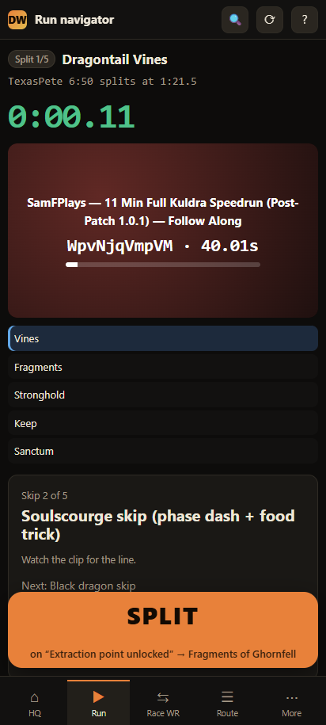
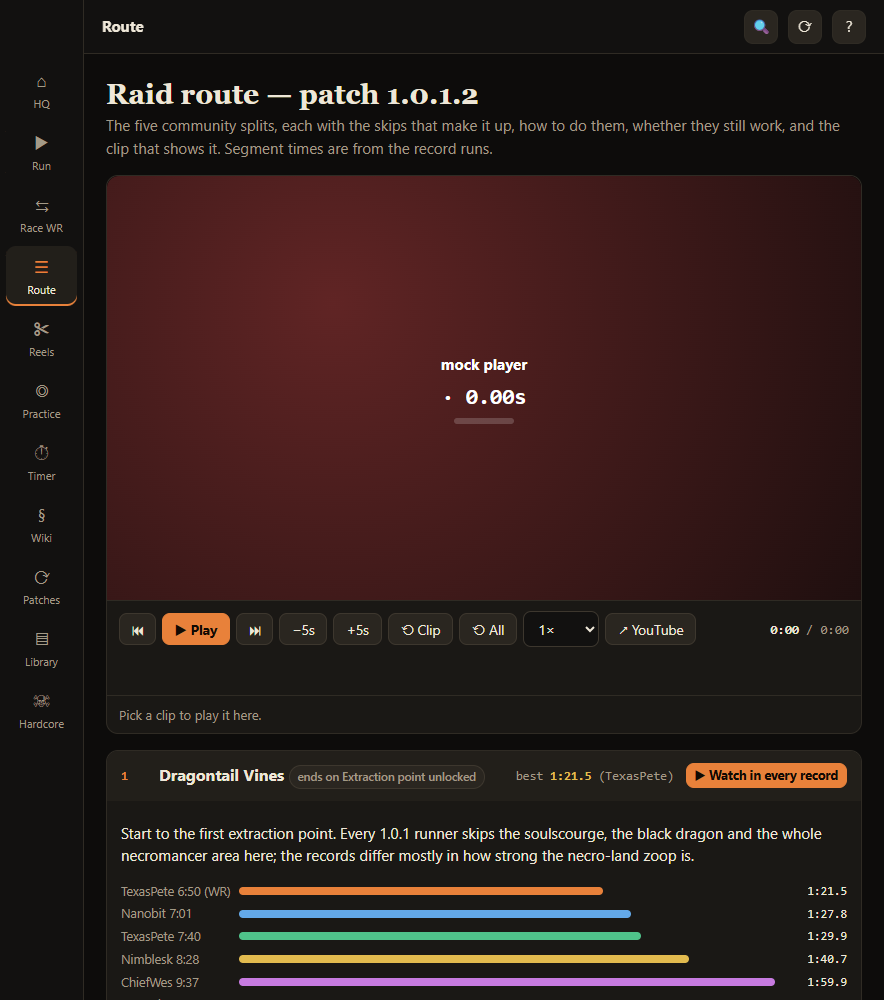
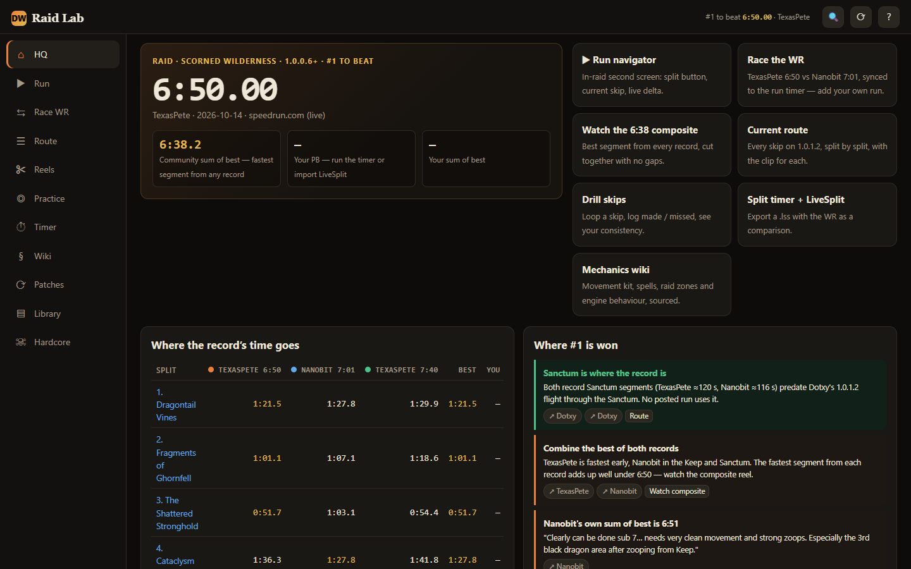

# Dragonwilds Raid Lab

**Live:** https://drthomasager.github.io/dragonwilds-speedrun/ · install it from there as an app.

Scorned Wilderness raid speedrun lab for RuneScape: Dragonwilds, built to take the #1 spot on the speedrun.com Raid board (1.0.0.6+). The current record is **6:50.00** (TexasPete).

| Phone (Fold folded) | Fold unfolded | Desktop |
|---|---|---|
|  |  |  |

## Install it as an app

It's a PWA. Open the site, then:
- **Pixel / Android (Chrome):** ⋮ → *Install app*, or tap **⤓ Install app** in the header. Works folded (phone layout, bottom tabs) and unfolded (rail layout). Turn on 🔔 on the Patch notes page to get an alert when a new patch touches the raid.
- **Windows (Edge or Chrome):** use the install icon in the address bar, or **⤓ Install app**. It opens in its own window and has shortcuts for Run, Race the WR, Timer and Patch notes.

It works offline for everything except the YouTube clips and the live leaderboard.

## Claude inside the app (your PC only)

```bash
bb lab          # or: npm run lab  ->  http://localhost:5180
```

This starts the **bridge** (`scripts/bridge.clj`, babashka). Open http://localhost:5180 and press **✦** (Ctrl+J):
- **Chat:** tell Claude what you want, Figma Make style, e.g. "make the split button bigger" or "why was my last run slow?". It edits the app on its own (auto permission mode), takes a screenshot to check its work (`scripts/look.mjs`), and the open app reloads by itself.
- **Live feed:** your splits, PBs, resets and practice results stream in as you play, so Claude knows what's happening. If RuneLite is running with the OSRS `client_repl` plugin (port 7889), it also polls a live game snapshot. Set `LAB_GAME_FILE` to also tail any game log file.
- **REPL:** run Clojure inside the game client. The bridge has its own nREPL on `localhost:1667` for your editor too.

Everything listens only on 127.0.0.1. The public website doesn't show the panel.

## Run it

```bash
npm install     # dev only: Playwright test runner (uses your installed Edge)
npm start       # http://localhost:5173
```

The site has no build step and nothing to bundle. It has to be served over http, because ES modules and the YouTube iframe API both fail on `file://`. GitHub Pages serves the `gh-pages` branch. `.github/workflows/publish.yml` copies `main` there on every push, and the hourly patch-notes job publishes too.

## What's in it

| Page | What it does |
|---|---|
| **Run navigator** | An in-raid second screen with one giant split button. It shows the skip you're on with large-print steps and a muted looping reference clip, your live delta against the WR (or your PB), and a pre-flight checklist. Runs save to the same history as the Timer. |
| **HQ** | Shows the live #1 from speedrun.com, the community sum of best (the fastest segment from any record, 6:38), where each record's time goes per split, and where #1 is won, with sources. |
| **Race the WR** | Plays up to 4 runs on one run clock. *Race* puts every video on the same timer value. *Split-aligned* starts every segment together, and faster runs wait on their split. Shows live deltas. Split marks can be adjusted live (±0.1 s, "= now") and every change re-syncs instantly. You can add your own run from a YouTube link and mark its splits with Z/S while watching. |
| **Route** | The 1.0.1.2 route split by split: each skip, how to do it, whether it still works, and its clips. It also has a **requirements timeline**: every skill, spell, item and quest the route needs, grouped by the Hardcore phase that unlocks it, with ticks for what you already have. |
| **Reel Studio** | Plays clips from any videos back to back with no gap: the next clip is pre-buffered on a hidden second player and cut in on the out-point. Drag in/out handles and the video follows the handle. You can preview each cut, loop a clip solo, reorder, share by link, and export/import. Presets include the 6:38 composite and each split across every record. |
| **Practice** | Loop a skip's reference clip and log made (J) or missed (K). Consistency is tracked per skip, and the weakest skip is suggested next. |
| **Timer** | A split timer with LiveSplit behaviour, golds and PB. It exports a `.lss` with the WR, Nanobit and the community sum of best as LiveSplit comparisons, and imports `.lss` history to analyse where your runs die. |
| **Mechanics wiki** | 45 sourced entries covering the movement kit, spells, stamina, items, every raid zone and boss, and engine and speedrun rules. Each entry links to the skips that use it and pulls matching lines from the live patch notes. |
| **Patch notes** | Official Jagex notes from Steam, mirrored hourly by a GitHub Action (`.github/workflows/patchnotes.yml`). The app refreshes them on open, every hour while open, and when you return to it, and the service worker refreshes them on close. Raid and movement lines are flagged, and the page warns when a patch is newer than the route's verified version. |
| **Library** | 45 videos with verified ids, durations and creator chapters, playable as clips. |
| **Hardcore 1→Max** | The account route checklist, with clips re-timed to real chapters. |
| **Hardcore Run mode** (`hardcore-run.html`) | The in-game companion: one step at a time, prep / run / review, pre-flight checklists, full-screen danger rules, undo. It uses the same data and progress as the checklist. |

Press `?` on any page to see its keyboard shortcuts.

## How the split data was measured

Every run's splits sit on the same trigger: the first frame showing the "EXTRACTION POINT UNLOCKED" banner (splits 1–4), and the cut to black after "GET OUT NOW!" (split 5, which is speedrun.com's end rule). Banner frames were found by template matching at 10 fps and then checked frame by frame. Each video's timer offset comes from reading the on-screen timer at 3+ frames. Precision is ±0.1 s. See `js/data/raid.js`.

## Tests

```bash
npm test               # 18 end-to-end tests at phone / Fold / desktop sizes + screenshots → docs/screens/<size>/
npm run test:youtube   # real YouTube embeds: cross-video cut + 2-video race sync
npm run check          # re-verify every video id is still live
npm run patchnotes     # refresh data/patchnotes.json from Steam
```

Not affiliated with Jagex. Every clip plays from its creator's channel and every skip credits its finder.
